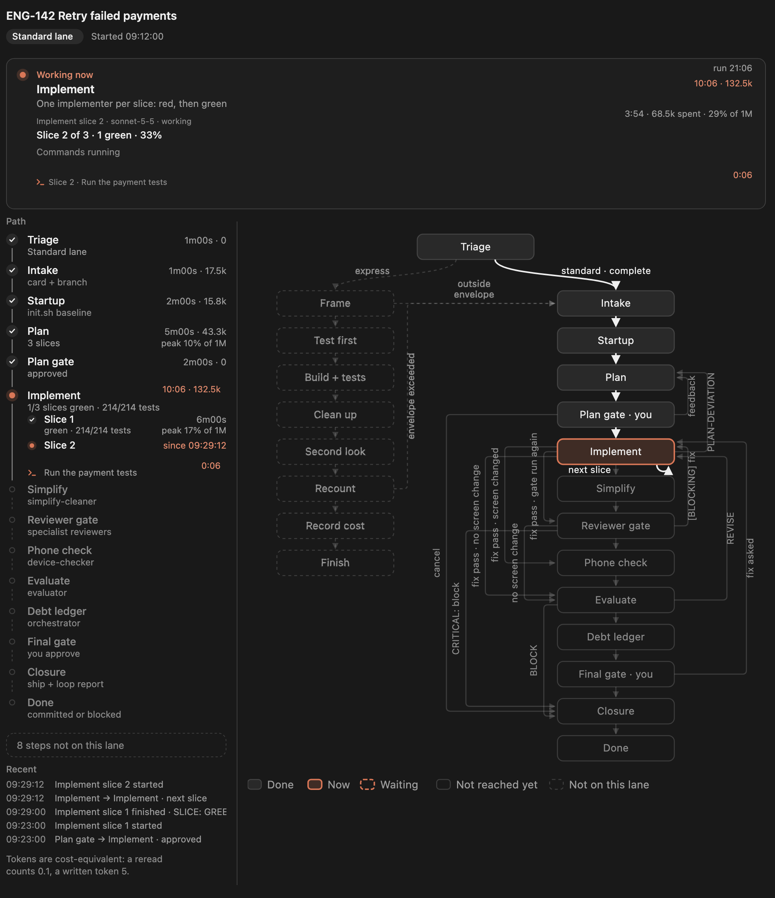

# loop-graph

A live graph of your project's agent loop, in a pane beside the chat. When Claude runs your loop (a skill or command that plans, sends subagents, tests, reviews and loops back), the pane shows:



- **Now**: the step at work and what it does, how long it has run and what it has spent, live. Each agent at work, its model, and how much of its context window it has used. The shell commands running past a few seconds, for the step or the agent running them. When the run waits on you (an approval gate, a question, a permission prompt), it says so and since when.
- **The path** this run takes: each step done with its time, tokens and what it came to (`3 tests failed`, `VERDICT: FIX`, `2 reviews · 0 critical · 1 high`), the arcs it took between steps, and the steps still ahead. A step that sends several agents lists each one under it, with its own time and the largest share of context it used.
- **The map** of the whole loop: every step and every arc, the arcs taken drawn over the rest with a count when crossed more than once. A move the map does not have shows as a red jump.
- **Alerts** worth a look or to act on: a failing test run or a bad verdict, an agent past 80 % or 90 % of its context or compacted, an agent silent for five minutes, a second pass back to the same step, a step past the number of rounds the loop allows, a prompt cache gone cold, an agent that ended without its report line.

The pane only moves when the loop says where it is: each step of your loop starts with one marker command, `node .claude/loop-graph/loop-step.mjs <step>`. Nothing is guessed from the commands the loop happens to run.

## Set it up in a project

Install the mod (below), then in your project ask Claude:

```
/loop-graph:setup
```

It finds your loop, reads it end to end, shows you a draft of its steps and arcs, and on your go-ahead:

- writes `.claude/loop-graph/map.json`, the loop's steps, arcs, lanes and how its agents and test runs report;
- copies the marker script to `.claude/loop-graph/loop-step.mjs`;
- adds one marker line at the start of each step in your loop's instructions;
- offers to allow the marker command, so the loop doesn't stop on a permission prompt at each step.

Then run `/loop-graph reload` (or start a new session) and run your loop. The pane opens with the first step. Commit `.claude/loop-graph/` and the marker edits, and everyone on the project gets the pane.

Run `/loop-graph:setup` again after the loop changes: it updates the map and the markers. The map's format is described in [`skills/setup/map-format.md`](skills/setup/map-format.md), with two complete examples in [`skills/setup/examples/`](skills/setup/examples/).

## Commands

- `/loop-graph` opens the pane.
- `/loop-graph reload` reads the map again after you edited it.
- `/loop-graph reset` clears the run (the Reset button in the pane does the same).

## Install

```sh
claude plugin marketplace add ziedgithub/claude-code-mods && claude plugin install loop-graph@zied-mods
```

Needs Claude Code 2.1.296 or later.

Then restart Claude Code.

See the [repository README](../README.md) for running it from a clone.
